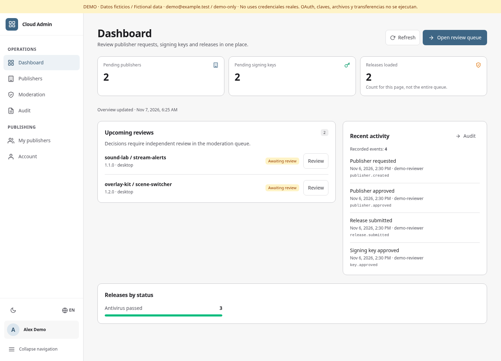
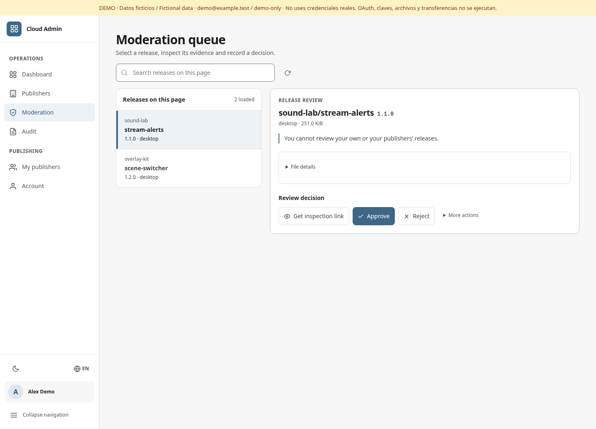
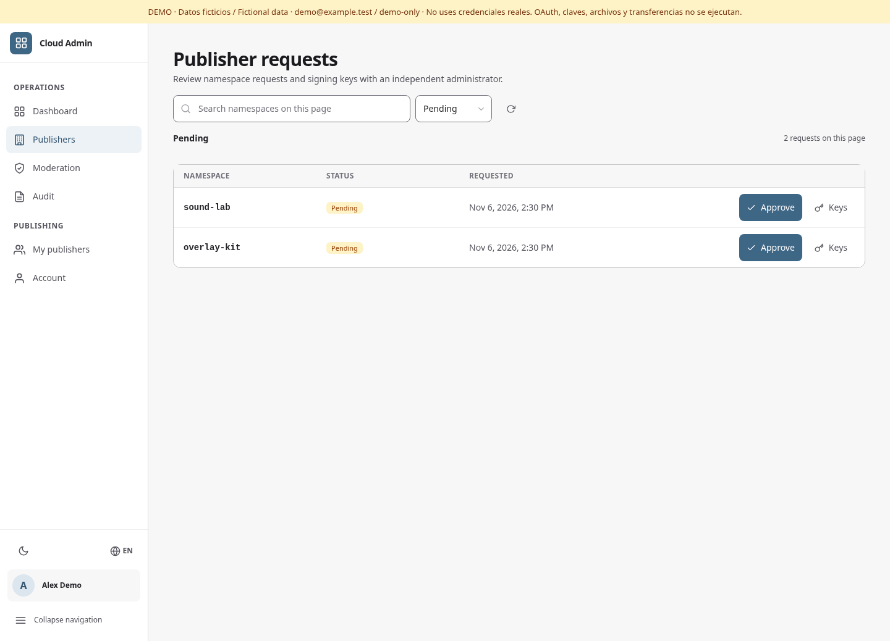
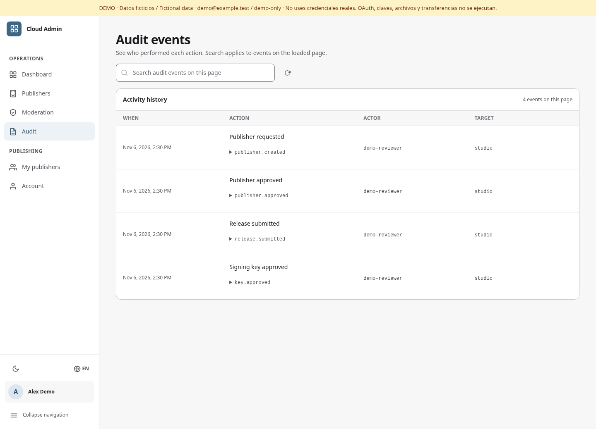
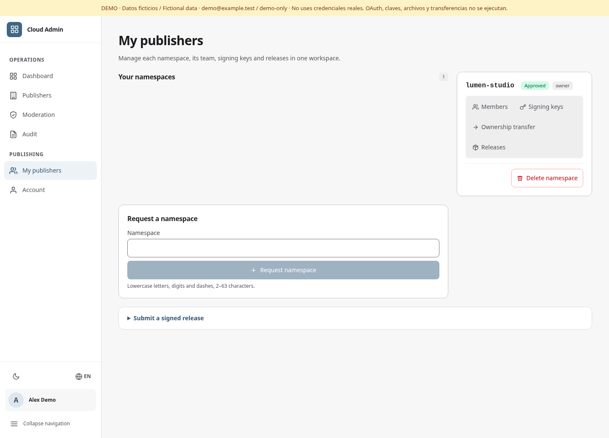
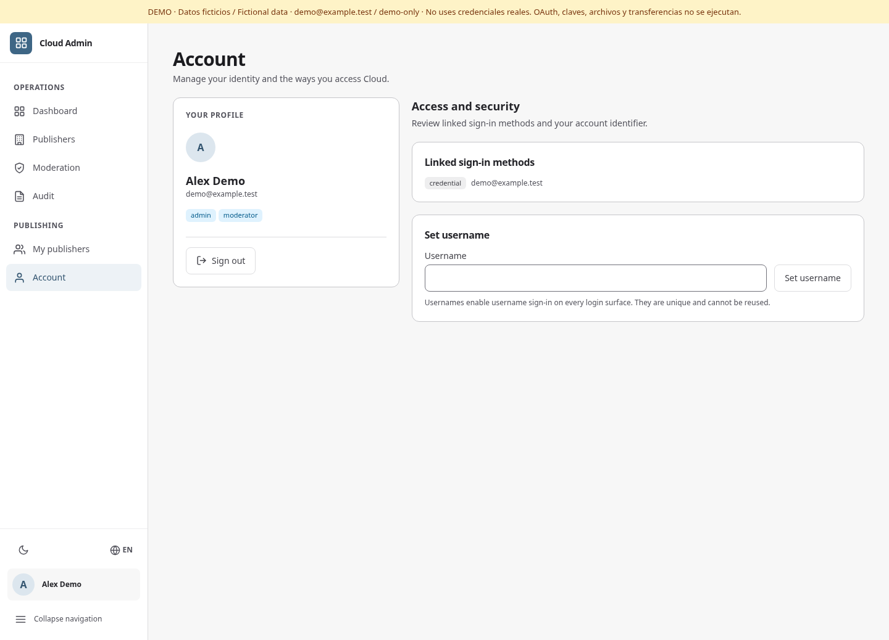
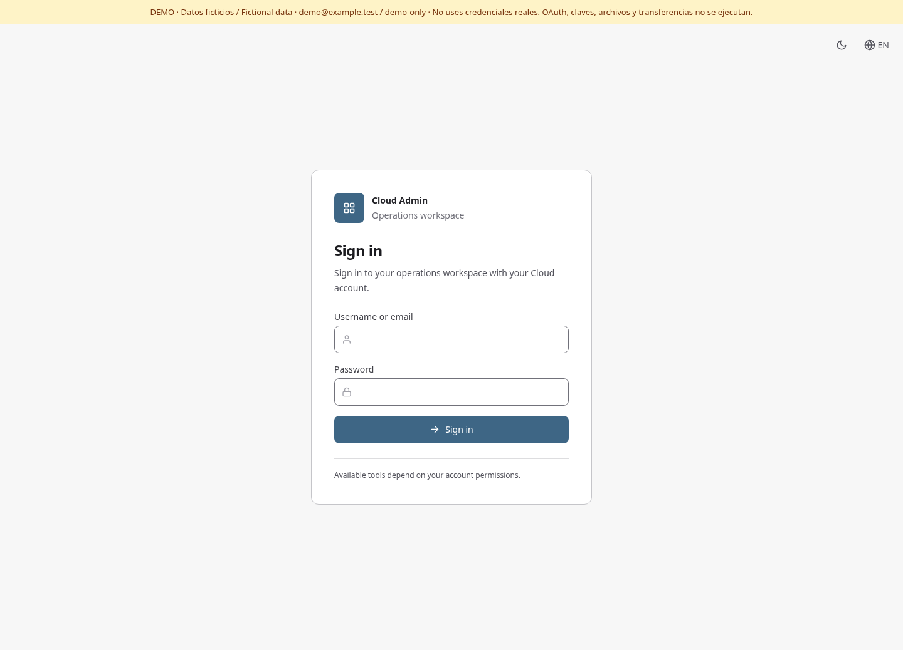
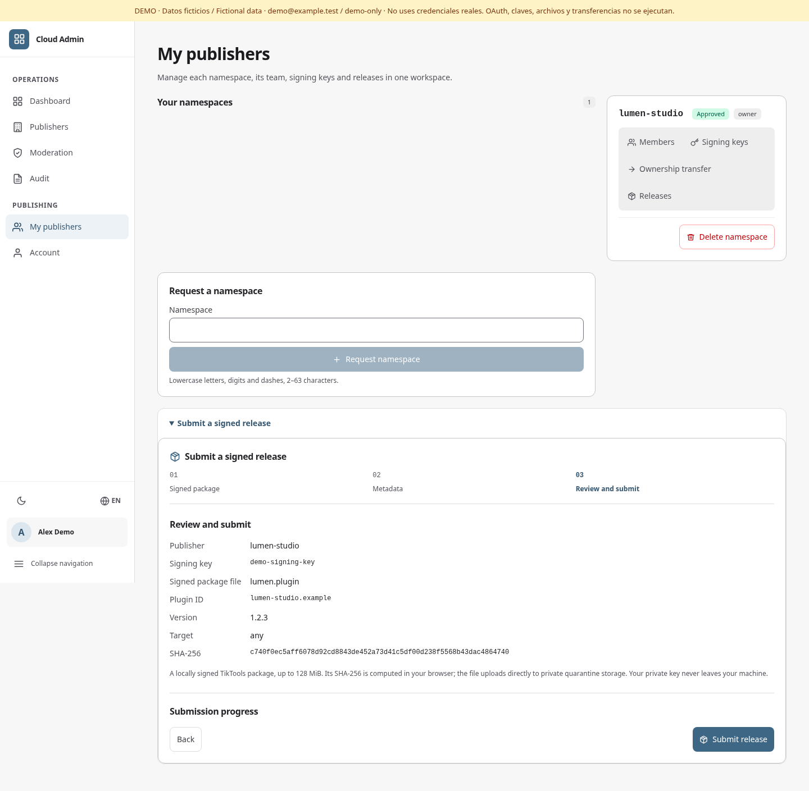
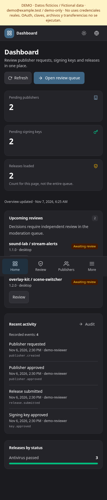
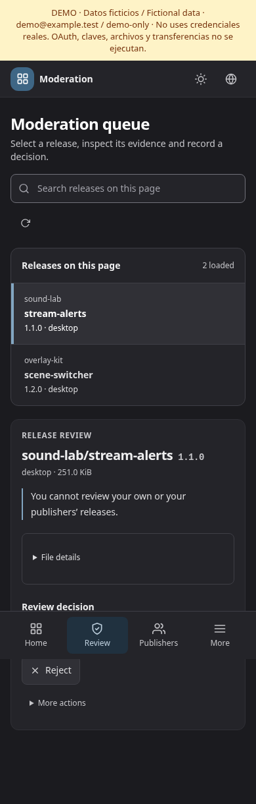

# PR #11: implemented UI screenshots

Real Chromium captures of the local backend-free demo, taken 2026-11-07 from the
implemented redesign with the neutral OBS-inspired palette. These are not concept renders.

All identities, namespace names, counts and records are demo fixtures. The displayed
`demo@example.test` / `demo-only` credentials are intentionally public, local-only
demo credentials, not production secrets. The release review uses a synthetic test
package and demo signing-key identifier; no private key or production token appears.

Desktop captures use a 1440 px viewport; mobile captures use 390 px. These are full
page captures: sticky/fixed navigation appears at its captured viewport position,
not at every vertical scroll position. No images have been edited.

## Desktop, light theme

## Mobile, dark theme

